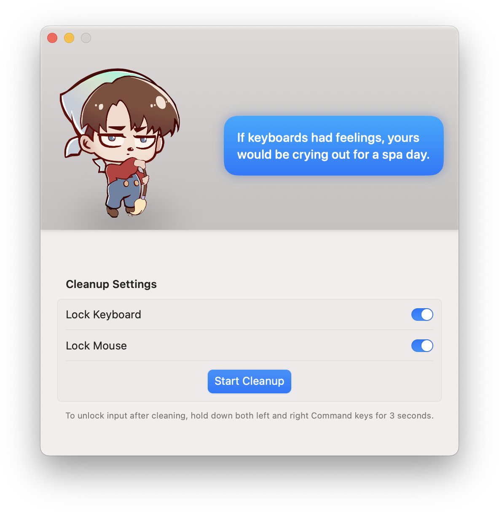

## 让清洁少一点误触

想擦一擦 Mac 的键盘和触控板，却担心按出一串文字或误点正在打开的窗口？CleanupBuddy 是一款简单的 macOS 小工具，可以在清洁时锁定键盘和鼠标或触控板的输入，让你不必为此关机。

## 按需锁定，清洁后恢复

打开 CleanupBuddy 后，可以在界面中选择是否锁定键盘和鼠标，再开始清洁。官网展示的界面还提示：清洁完成后，同时按住左右两侧的 Command 键三秒即可解锁输入。使用时请留意应用界面中的具体提示。

除了实用的输入锁定，界面里还有一位动画角色和趣味提示，让日常清洁多一点轻松的气氛。

## 安装与系统要求

CleanupBuddy 需要 macOS Ventura 13 或更高版本。可以通过官网获取，也可以使用页面上方的 Homebrew 命令安装。
