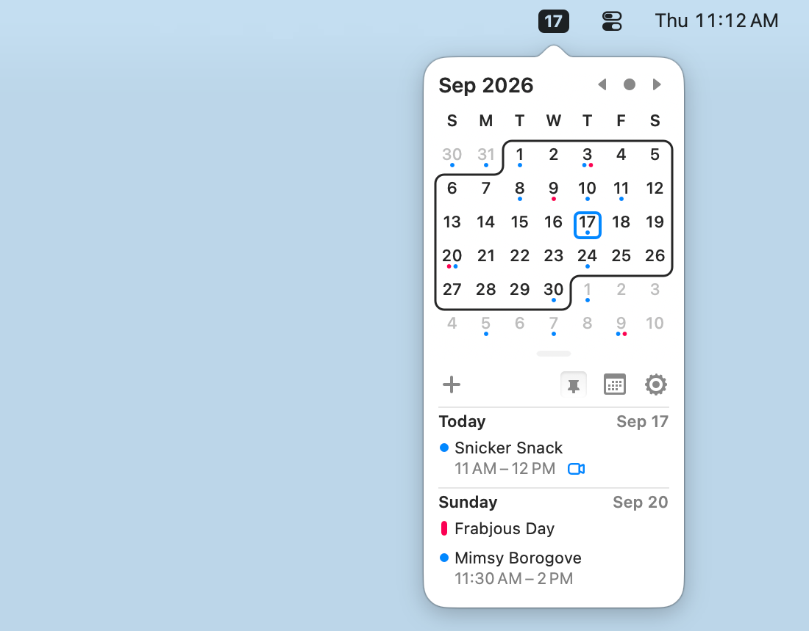

## 在菜单栏查看日程

Itsycal 是一款 macOS 菜单栏日历。点击菜单栏图标即可查看日期和日程，适合想在工作时快速确认日期、查看接下来安排的人。

它可以与 Mac 的「日历」应用配合，显示日历事件，也可以创建和删除事件；如需编辑已有事件，可以使用「日历」应用。日程中包含会议链接时，Itsycal 也支持加入线上会议。

## 按自己的习惯浏览

Itsycal 支持显示 ISO 周数、同时显示最多两个月，以及调整字体大小和深色模式。你可以设置快捷键打开日历，使用键盘浏览或跳转到指定日期，也可以自定义菜单栏时钟的显示。

## 安装与系统要求

可以从官网选择与 macOS 版本对应的下载，也可以使用上方的 Homebrew 命令安装。官网提供适用于 macOS 27 及更高版本和 macOS 11 及更高版本的下载，旧系统版本可在官网的版本历史中查找。
