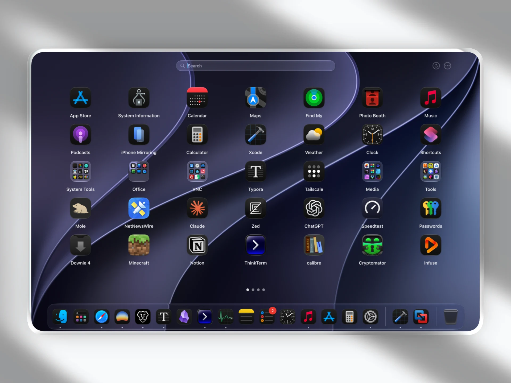

## 找回熟悉的应用启动界面

LaunchNext 是一款免费、开源的 macOS 应用启动器，提供类似经典 Launchpad 的网格界面。它适合希望通过图标浏览应用、自己安排位置和文件夹的用户，也可以从原有 Launchpad 导入布局。

## 按自己的习惯整理和启动

- 拖动应用图标调整位置或整理文件夹，也可以隐藏不需要显示的应用。
- 调整图标大小、网格行列和背景，在窗口与全屏模式之间切换。
- 通过搜索和键盘导航打开应用；搜索支持拼音匹配。
- 设置快捷键或热角，快速打开启动器。

## 系统与安装

LaunchNext 支持 macOS 26 及以上版本，可在 Apple Silicon 和 Intel Mac 上运行。可从项目的 GitHub Releases 页面下载；安装后可以在设置中导入原有 Launchpad 布局。
